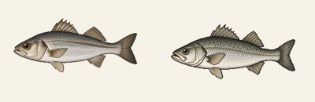
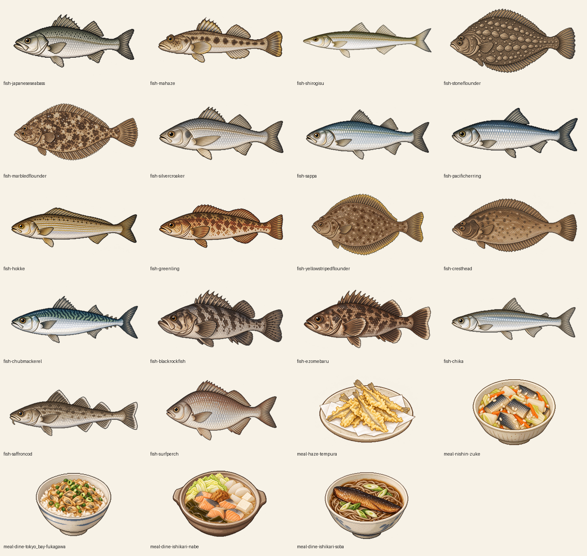

# 圖像第八批說明：第 4 批東京灣、石狩灣（已完成）

2026-10-23 依使用者指示完成本批 23 張圖片：18 種新魚、2 道自製料理、3 道餐廳料理。已接入圖鑑、漁獲箱、本水域魚種彈窗與料理頁；未發現物種仍隱藏圖片。使用內建 imagegen 生成，未使用 API 或程式繪圖替代。

繪製前依根目錄 `AGENT.md`「插圖風格與驗收」：先實際查看 `assets/pixel-atlas-01-clear.png`、`assets/animal-nipponense.png` 與 0.21 的 `assets/sprites16/fish-*.png`、`meal-*.png`，作為直接風格參考輸入；先完成一張代表圖並排比對，再延續整批。物種形態依下表與圖鑑正文，不要把參考圖的外形或斑紋移到新物種。

## 本批清單

| 圖位 | 檔名（assets/sprites16/） | 中文名 | 學名 | 辨識重點 |
| ---: | --- | --- | --- | --- |
| 314 | fish-japaneseseabass.png | 日本花鱸 | Lateolabrax japonicus | 修長側扁、背灰綠腹銀白；背上散布小黑點；口大、下頜略突；背鰭硬棘與軟條分兩段 |
| 315 | fish-mahaze.png | 黃鰭刺鰕虎 | Acanthogobius flavimanus | 細長鰕虎、頭大略扁、兩眼在頭頂；淡褐色體側一列暗斑；兩枚背鰭 |
| 316 | fish-shirogisu.png | 日本沙鮻 | Sillago japonica | 細長、吻尖；背灰綠、頭頂較深、腹白；鰭多透明，尾鰭邊緣暗 |
| 317 | fish-stoneflounder.png | 石鰈 | Kareius bicoloratus | 右眼型鰈魚，卵圓形；有眼側灰褐、無鱗，背上數列石塊狀骨板 |
| 318 | fish-marbledflounder.png | 橫濱擬鰈 | Pseudopleuronectes yokohamae | 右眼型、身體寬短；褐色帶不規則深淺斑紋，口很小 |
| 319 | fish-silvercroaker.png | 白姑魚 | Pennahia argentata | 紡錘形石首魚，全身銀白，鰓蓋一塊黑斑；胸鰭長 |
| 320 | fish-sappa.png | 壽南小沙丁魚 | Sardinella zunasi | 側扁小鯡魚，背青、體側銀白，腹緣稜鱗；背鰭起點無黑點 |
| 321 | fish-pacificherring.png | 太平洋鯡 | Clupea pallasii | 流線形，背深藍到橄欖色、體側銀白，無明顯斑點 |
| 322 | fish-hokke.png | 遠東多線魚 | Pleurogrammus azonus | 紡錘形、背鰭長而連續；體側五條側線；黃褐色斑紋 |
| 323 | fish-greenling.png | 大瀧六線魚 | Hexagrammos otakii | 細長、黃褐至紅褐；背鰭中段淺凹；尾鰭後緣平直或稍內凹 |
| 324 | fish-yellowstripedflounder.png | 黃條紋擬鰈 | Pseudopleuronectes herzensteini | 右眼型卵圓形；有眼側褐色（無眼側背、臀鰭基部黃帶，側視圖可在鰭緣透出一點黃） |
| 325 | fish-cresthead.png | 斯氏擬鰈 | Pseudopleuronectes schrenki | 右眼型，與黃條紋擬鰈相似但頭部顏色明顯較深 |
| 326 | fish-chubmackerel.png | 白腹鯖 | Scomber japonicus | 紡錘形、背青綠帶彎曲波狀黑紋、腹部銀白無斑；兩背鰭分離、尾柄有小離鰭 |
| 327 | fish-blackrockfish.png | 許氏平鮋 | Sebastes schlegelii | 頭大口大、全身灰黑；眼下斜向暗帶；背鰭硬棘發達 |
| 328 | fish-ezomebaru.png | 邊尾平鮋 | Sebastes taczanowskii | 體高側扁的小型平鮋，暗褐帶斑；眼大、背鰭硬棘尖 |
| 329 | fish-chika.png | 日本公魚 | Hypomesus japonicus | 細長銀色小魚，背上一枚小脂鰭；眼小（與西太公魚相似） |
| 330 | fish-saffroncod.png | 細身寬突鱈 | Eleginus gracilis | 三枚背鰭、兩枚臀鰭；下頜較短、頦鬚短；灰褐帶模糊暗斑，背鰭與尾鰭白邊 |
| 331 | fish-surfperch.png | 海鯽 | Ditrema temminckii | 體高側扁如葉片，銀白至紅褐 |
| 332 | meal-haze-tempura.png | 鰕虎天婦羅 | — | 剖開去骨的小鰕虎裹薄麵衣炸成金黃，盛在天婦羅紙上 |
| 333 | meal-nishin-zuke.png | 鯡魚漬 | — | 切段的身欠鯡與白蘿蔔塊、高麗菜、紅蘿蔔絲、米麴醃在一起，小缽盛裝 |
| 334 | meal-dine-tokyo_bay-fukagawa.png | 深川飯 | — | 白飯上澆蛤蜊與蔥的味噌煮，碗裝 |
| 335 | meal-dine-ishikari-nabe.png | 石狩鍋 | — | 鐵鍋或土鍋，昆布鋪底，鮭魚塊、高麗菜、白蘿蔔、豆腐圍著中央的味噌 |
| 336 | meal-dine-ishikari-soba.png | 鯡魚蕎麥麵 | — | 熱湯蕎麥麵上放一片甘露煮鯡魚、斜切蔥段 |

魚類頭朝左、完整側視；比目魚沿用既有歐洲川鰈、歐洲鰨的有眼側俯視角度。透明背景、只裁透明空白，等比例縮至最長邊 320 像素、四周留 4 像素，與 0.21 sprites16 相同。

## 繪製與風格校對

實際查看本版 pixel-atlas-01-clear.png、animal-nipponense.png，以及 0.21 的歐洲鱸、歐洲鰨、霞浦手長蝦唐揚成品。生成時直接輸入圖集與同類魚圖／料理圖作風格參考，物種形態依本表獨立描述。先繪日本花鱸，在暖白背景、約 170 像素寬下與歐洲鱸並排比對，再延續整批。日本沙鮻、遠東多線魚、大瀧六線魚另修正吻部、連續背鰭與尾緣。只裁透明空白並等比例縮放，最長邊 320 像素（內容 312 加兩側各 4 像素），未使用強制像素化濾鏡。

## 提示詞與來源

共通提示詞要求「ONE standalone transparent game sprite」「muted natural-history pixel illustration」「visible pixel stair-step contours」「limited layered shading」「subdued highlights」，風格參考不得移植魚種外形或斑紋；魚類完整左向，料理為單份完整菜餚，不含文字、環境、外框或投影。各圖另附上學名與本表辨識重點。完整逐張提示詞、生成來源及形態修正記錄見 [圖像第八批提示詞.json](圖像第八批提示詞.json)。

## 實裝與驗證

接入前以程式核對 pixelBounds[20].rects.length 為 10。collections.js 加入魚圖 314～331、料理 332～336，第 20 組補足 16 格，第 21 組 16 格，第 22 組 1 格，尺寸逐檔取自 PNG。index.html 資源參數更新為 0.22-2。revision15 刪除 pending22 排除清單並檢查 300 個不重複圖位，batch22 改查檔案存在、發現前隱藏及發現後 sprites16 圖片引用。

23 張圖均為 RGBA、保留真正透明背景與完整邊距，逐張檢視外形、辨識特徵與裁切。20 套既有程式測試全部通過，結果見 tests/results22-art.json。另以本機瀏覽器確認 23 張 PNG 全部可解碼，在 1280、390、320 像素寬下逐一核對 18 種魚的圖鑑與漁獲箱、兩灣魚種彈窗及 5 道料理詳情；手機卡片改為圖片在上、名稱在下，長魚名可完整換行；最終 1280／390／320 像素頁寬均與視窗一致，詳情與彈窗寬度在視窗內，未捕獲魚種沒有圖片，未解鎖自製料理隱藏，主控台無錯誤。尺寸、雜湊與瀏覽器結果見 [圖像第八批驗證.json](圖像第八批驗證.json)，截圖及執行工具保留在根目錄 work/art22/。本次只完成本機實裝，未公開發布。

| 圖片 | 尺寸 |
| --- | --- |
| fish-japaneseseabass.png | 320×186 |
| fish-mahaze.png | 320×130 |
| fish-shirogisu.png | 320×159 |
| fish-stoneflounder.png | 320×173 |
| fish-marbledflounder.png | 320×164 |
| fish-silvercroaker.png | 320×162 |
| fish-sappa.png | 320×164 |
| fish-pacificherring.png | 320×149 |
| fish-hokke.png | 320×166 |
| fish-greenling.png | 320×141 |
| fish-yellowstripedflounder.png | 320×203 |
| fish-cresthead.png | 320×164 |
| fish-chubmackerel.png | 320×167 |
| fish-blackrockfish.png | 320×164 |
| fish-ezomebaru.png | 320×164 |
| fish-chika.png | 320×141 |
| fish-saffroncod.png | 320×168 |
| fish-surfperch.png | 320×207 |
| meal-haze-tempura.png | 320×216 |
| meal-nishin-zuke.png | 320×265 |
| meal-dine-tokyo_bay-fukagawa.png | 320×263 |
| meal-dine-ishikari-nabe.png | 320×248 |
| meal-dine-ishikari-soba.png | 320×247 |

## 後續公開發布

2026-10-23：依作者指示發布 0.22 至既有 GitHub Pages，提交 344fc9287f77f7fe1a2e57de08b146c091e3967a。部署狀態 built；179 個公開程式與 PNG 和本機版本一致（文字正規化 BOM／CRLF，PNG 逐位元組比對）。公開瀏覽器驗證 23 張新圖、未發現時隱藏、1280／390／320 像素的圖鑑、漁獲箱、兩灣彈窗與五道料理詳情，頁寬正常且無主控台錯誤；另驗證東京灣與石狩灣首次旅行扣款、釣魚結算、存檔重載。結果保留在根目錄 work/deployment-022.json、work/art22/public-browser.json 與 public-flow.json。
